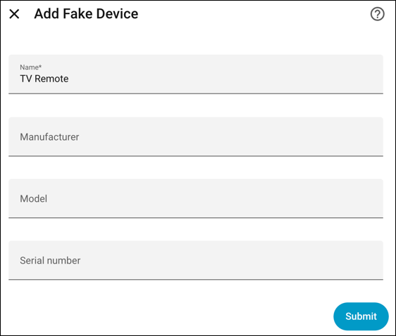

<!-- ha-marketplace:exclude-start -->
# Fake Devices Home Assistant Integration

[![GitHub Release][releases-shield]][releases]
[![GitHub Activity][commits-shield]][commits]
[![Downloads][download-latest-shield]]()
[![Installs][marketplace-installs-shield]][hacs-install]
[![marketplace][marketplacebadge]][marketplace]
[![License][license-shield]](LICENSE)

<!-- ha-marketplace:exclude-end -->
This integration creates fake devices in Home Assistant, useful for adding helper integrations like [Battery Notes](https://github.com/andrew-codechimp/ha-battery-notes) to real world non-smart devices that are not in Home Assistant, for example TV Remotes and Wall Clocks.

You can add the device name, manufacturer, model and serial number, plus model id, hardware, firmware and a URL as optional additional information. You can use these to store any short piece of text you want.

You can also add an optional MAC address. The MAC address must be six hexadecimal pairs separated by colons or hyphens, three dotted groups of four digits, or 12 hexadecimal digits (for example, `AA:BB:CC:DD:EE:FF`, `AA-BB-CC-DD-EE-FF`, `AABB.CCDD.EEFF` or `AABBCCDDEEFF`). Home Assistant applies device matching and collision rules.

No entities are created, it's just a device placeholder for using with helpers where you have the option to add to a device.

_Please ⭐ this repo on [GitHub][repository] if you find it useful_

<!-- ha-marketplace:exclude-start -->
## Marketplace/HACS Installation

Or search for Fake Devices within Marketplace/HACS.
<!-- ha-marketplace:exclude-end -->

[repository]: https://github.com/andrew-codechimp/HA-Fake-Devices
[commits-shield]: https://img.shields.io/github/commit-activity/y/andrew-codechimp/HA-Fake-Devices.svg?style=for-the-badge
[commits]: https://github.com/andrew-codechimp/HA-Fake-Devices/commits/main
[license-shield]: https://img.shields.io/github/license/andrew-codechimp/HA-Fake-Devices.svg?style=for-the-badge
[releases-shield]: https://img.shields.io/github/release/andrew-codechimp/HA-Fake-Devices.svg?style=for-the-badge
[releases]: https://github.com/andrew-codechimp/HA-Fake-Devices/releases
[download-latest-shield]: https://img.shields.io/github/downloads/andrew-codechimp/HA-Fake-Devices/latest/total?style=for-the-badge
[marketplace-installs-shield]: https://img.shields.io/badge/dynamic/json?url=https%3A%2F%2Fanalytics.home-assistant.io%2Fcustom_integrations.json&query=%24.fake_devices.total&style=for-the-badge&label=Marketplace%20installs
[marketplace-install]: https://my.home-assistant.io/redirect/marketplace_repository/?owner=andrew-codechimp&repository=fake_devices&category=integration
[hacs-install]: https://my.home-assistant.io/redirect/hacs_repository/?owner=andrew-codechimp&repository=HA-Fake-Devices&category=Integration
[marketplace]: https://home-assistant.io/integrations/marketplace
[marketplacebadge]: https://img.shields.io/badge/Marketplace-Default-41BDF5.svg?style=for-the-badge
